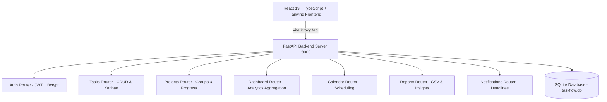

# ⚡ TaskFlow — Smart Task Management Platform

> **Full-Stack Productivity & Project Management System** — Built as part of a Software Development Internship at **Auspify Technologies**


---

## 📋 Table of Contents

- [Overview](#overview)
- [Key Features](#key-features)
- [System Architecture](#system-architecture)
- [Demo Credentials](#demo-credentials)
- [Installation & Quickstart](#installation--quickstart)
- [API Reference](#api-reference)
- [Database Schema](#database-schema)
- [Automated Testing](#automated-testing)
- [Author & Acknowledgments](#author--acknowledgments)

---

## Overview

**TaskFlow** is an enterprise-grade, modern task and project management platform designed to streamline collaborative workflows, boost personal productivity, and provide real-time analytical insight. 

Built on a robust decoupled architecture featuring **FastAPI**, **SQLAlchemy ORM**, **SQLite**, and **React 19 + TypeScript**, TaskFlow delivers instant responsiveness, secure JWT-based multi-tenant user isolation, dynamic Kanban drag-and-drop workflows, and interactive productivity analytics.

---

## Key Features

- 📊 **Executive Dashboard**: Real-time stats on completed, in-progress, overdue, and urgent tasks with weekly completion charts and priority breakdowns.
- 🗂️ **Interactive Kanban Board**: Visual workflow boards with drag-and-drop state transitions across *To Do*, *In Progress*, *In Review*, and *Completed*.
- 📋 **Advanced Task Management**: Full CRUD operations, priority tags (Low, Medium, High, Critical), category tagging, start & due dates, search & multi-attribute filtering.
- 📁 **Project Hub**: Organize tasks under dedicated projects with custom color tags, progress bars, and completion analytics.
- 📅 **Visual Calendar**: Monthly deadline scheduling view highlighting upcoming project deadlines and task milestones.
- 📈 **Productivity Analytics & CSV Export**: Detailed progress tracking with one-click export of task logs to CSV.
- 🔔 **Intelligent Notifications**: Automated system triggers detecting overdue tasks and approaching 48-hour deadlines with one-click read status management.
- 👤 **Profile & Security**: User profile customization, secure bcrypt password hashing, and token expiration handling.

---

## System Architecture



---

## Demo Credentials

The database automatically seeds with rich, realistic project and task data on initial startup:

- **Email**: `demo@taskflow.io`
- **Password**: `password123`

You can also register a new account on the authentication page at any time with complete data isolation.

---

## Installation & Quickstart

### One-Click Launch (Recommended)
You can start both the backend and frontend simultaneously by double-clicking or running:
```bash
start.bat
```

### Manual Setup

#### Prerequisites
- Python 3.10 or higher
- Node.js 18+ & npm

#### 1. Backend Setup
```bash
cd backend

# Install dependencies
python -m pip install -r requirements.txt

# Run the FastAPI server on dedicated port 8002
python -m uvicorn main:app --reload --host 127.0.0.1 --port 8002
```
- API Base URL: `http://127.0.0.1:8002`
- Health Endpoint: `http://127.0.0.1:8002/api/health`
- Interactive Swagger UI: `http://127.0.0.1:8002/docs`
- ReDoc: `http://127.0.0.1:8002/redoc`

#### 2. Frontend Setup
```bash
cd frontend

# Install dependencies
npm install

# Start development server on dedicated port 5175
npm run dev
```
- Frontend application: `http://localhost:5175`
*(Vite proxies `/api` requests directly to `http://127.0.0.1:8002`)*


---

## Database Schema

| Table | Purpose |
|-------|---------|
| `users` | User accounts, credentials (bcrypt), profiles, and roles |
| `projects` | High-level initiatives with color coding, deadlines, and categories |
| `tasks` | Actionable work items tied to users and optional projects |
| `notifications` | Deadline warnings, overdue alerts, and system notifications |
| `activity_logs` | Audit trail of user actions across tasks and projects |

---

## Automated Testing

TaskFlow includes an automated integration test suite verifying all 10 core API modules:

```bash
cd backend
python test_api.py
```

### Test Suite Summary

| Test Case | Module Covered | Status |
|-----------|----------------|--------|
| `test_01_root_health` | Health Check & API Metadata | ✅ PASSED |
| `test_02_demo_login` | JWT Authentication & Credentials | ✅ PASSED |
| `test_03_dashboard_stats` | Dashboard Analytics & Aggregations | ✅ PASSED |
| `test_04_tasks_crud_and_status` | Task Creation, Lookup, Status & Deletion | ✅ PASSED |
| `test_05_reports_and_csv` | Analytics Reporting & CSV Export | ✅ PASSED |
| `test_06_user_data_isolation` | Multi-Tenant Data Isolation | ✅ PASSED |
| `test_07_projects_crud` | Projects CRUD & Statistics | ✅ PASSED |
| `test_08_calendar_events` | Calendar Tasks & Month Scheduling | ✅ PASSED |
| `test_09_notifications` | Auto-Detection & Read Status | ✅ PASSED |
| `test_10_user_profile` | Profile Updates & /me Inspection | ✅ PASSED |

---

## Author & Acknowledgments

- **Built with ❤️ as part of the Software Development Internship at Auspify Technologies.**
- Developed using modern standards in API development and responsive front-end engineering.
